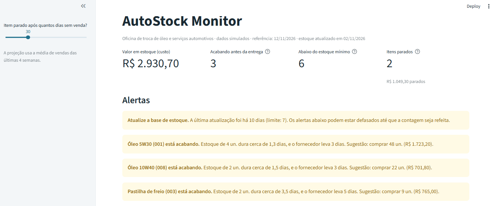
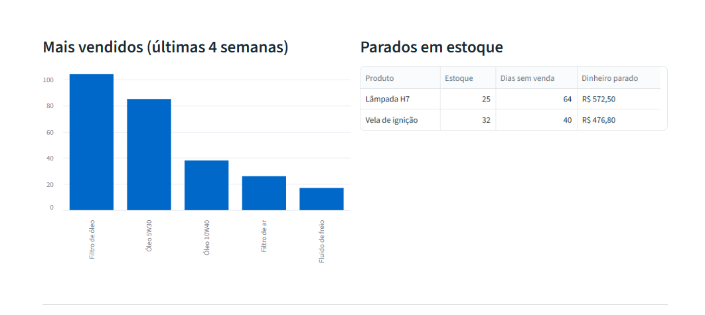
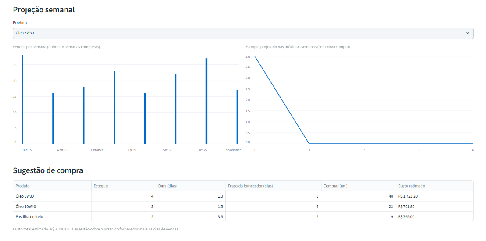

# AutoStock Monitor

Painel e rotina de alertas de estoque para uma **oficina de troca de óleo e serviços automotivos de cidade pequena**, que hoje controla o estoque "de memória": falta o que vende muito e sobra o que não vende.

> **Dados 100% simulados.** O projeto parte de um problema real e comum em pequenos negócios, mas todos os números (produtos, estoque, vendas) foram inventados para fins de demonstração. As vendas vêm de uma simulação reproduzível (`src/simulacao.py`).







## O que o projeto responde

| Pergunta do dono | Como o projeto responde |
|---|---|
| O que está para acabar? | Cobertura em dias comparada ao prazo do fornecedor, com sugestão de compra |
| O que vende muito? | Ranking das últimas 4 semanas e curva ABC |
| O que está parado? | Dias sem venda e dinheiro imobilizado |
| Como ficará o estoque na semana que vem? | Projeção semanal por média móvel de 4 semanas |
| Os números ainda são confiáveis? | Alerta quando a base de estoque está desatualizada |

Os alertas (base desatualizada e produto acabando) saem como e-mail de texto. O envio real é opcional; por padrão o projeto só mostra o e-mail na tela.

## Como rodar

Requer Python 3.10 ou superior. A partir da raiz do projeto:

```bash
python -m venv .venv
.venv\Scripts\activate            # Windows (Linux/macOS: source .venv/bin/activate)
pip install -r requirements.txt

python src/pipeline.py             # simula vendas, cria o banco, calcula e mostra alertas
streamlit run src/dashboard.py     # abre o painel no navegador
python -m pytest                   # roda os testes
```

Para resultados idênticos aos de qualquer outra pessoa, fixe a data: `python src/pipeline.py --hoje 2026-11-12`.

## Estrutura

```
data/
  produtos.csv               cadastro e estoque atual (simulado)
  parametros_simulacao.csv   "verdade secreta" da simulação: média de vendas por dia
  vendas.csv                 histórico (gerado pelo pipeline; não versionado)
  saidas/                    tabelas exportadas (ignoradas pelo Git; úteis para Power BI)
src/
  config.py        regras e caminhos em um só lugar
  simulacao.py     gera 16 semanas de vendas (Poisson + sazonalidade semanal)
  banco.py         SQLite: tabelas, validação, carga e leitura
  analise.py       indicadores (cobertura, parados, ABC, projeção)
  alertas.py       regras de alerta e envio de e-mail
  pipeline.py      orquestra tudo, na linha de comando
  dashboard.py     painel em Streamlit
tests/             testes automatizados (pytest)
docs/              capturas do painel
```

Fluxo: `produtos.csv` + vendas (simuladas ou reais) → **SQLite** → **análises em pandas** → **dashboard**, **alertas** e **CSVs exportados**.

## Definições dos indicadores

- **Média diária:** unidades vendidas nos últimos 28 dias ÷ 28 (média móvel de 4 semanas).
- **Cobertura (dias):** estoque ÷ média diária.
- **Acabando (ruptura iminente):** cobertura ≤ prazo de entrega do fornecedor.
- **Abaixo do mínimo:** estoque < estoque mínimo cadastrado (igual ao mínimo ainda não conta).
- **Parado:** sem vendas há 30 dias ou mais (ajustável no painel) e com estoque.
- **Sugestão de compra:** demanda esperada em (prazo + 14 dias) − estoque atual.
- **Curva ABC:** A até 80% da receita acumulada, B até 95%, C o restante.
- **Projeção:** estoque − média semanal × semanas, nunca abaixo de zero e sem considerar novas compras.

## Decisões de projeto

- **Regra do mínimo × cobertura.** O mínimo cadastrado costuma ser um palpite. Comparar a cobertura ao prazo do fornecedor mostra quando um item abaixo do mínimo ainda não é urgente (e quando um item acima dele está em risco).
- **Parâmetros da simulação fora da análise.** A análise só enxerga as vendas geradas, nunca as médias usadas para gerá-las, como num caso real.
- **Conferência cruzada.** Um teste compara o mesmo indicador calculado em SQL e em pandas.
- **Validação na entrada.** Códigos duplicados, valores negativos e decimais com vírgula são rejeitados com mensagem clara.
- **Segredos fora do código.** A senha do e-mail fica em `.env`, que está no `.gitignore`.

## Alertas por e-mail

Copie `.env.example` para `.env`, preencha os dados do seu provedor SMTP (provedores como o Gmail costumam exigir uma "senha de aplicativo") e rode:

```bash
python src/pipeline.py --enviar-email
```

Sem `--enviar-email`, o texto do e-mail é apenas exibido. Para disparar todo dia, agende o comando no Agendador de Tarefas do Windows ou no `cron`.

## Usando dados reais

1. Coloque a exportação do sistema de vendas em `data/real/` (pasta ignorada pelo Git).
2. Garanta as colunas `data`, `codigo`, `quantidade`, ou traduza os nomes com `banco.ler_vendas_csv(caminho, mapa_colunas=..., dayfirst=True)`.
3. Ajuste `data/produtos.csv` com o estoque contado e rode `python src/pipeline.py --vendas-csv data/real/vendas.csv --estoque-atualizado-em AAAA-MM-DD`.

## Limitações e próximos passos

- O estoque atual vem do cadastro (contagem), não de entradas e saídas. Registrar compras permitiria calcular o estoque automaticamente.
- A demanda é estimada por média móvel. Vendas sazonais ou em falta (demanda não atendida) pedem modelos mais sofisticados.
- A simulação assume vendas independentes entre produtos; na prática, óleo e filtro costumam sair juntos.
- Próximos passos: tabela de compras, intervalo de confiança da projeção, estoque de segurança estatístico e versão em Power BI.
